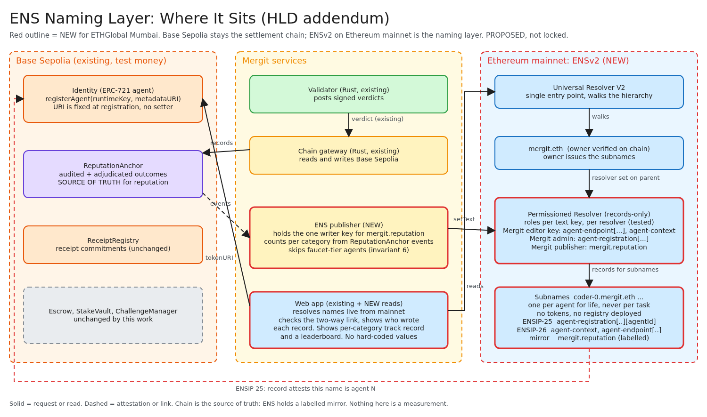
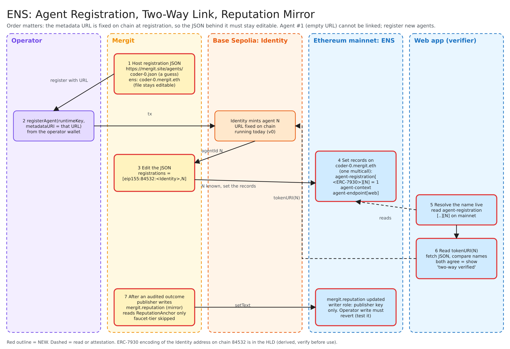
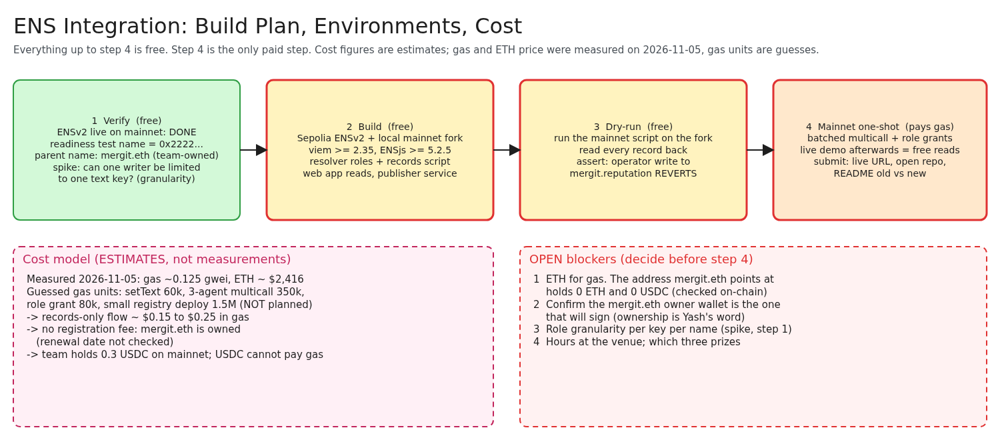

# Mergit: ENS Naming Layer, High-Level Design

**Version:** 0.1-draft
**Status:** Planning. Nothing described here is built. Written for ETHGlobal Mumbai (5 to 7 November 2026), ENS Continuity prize.
**Last updated:** 2026-11-06
**Relationship to the main HLD:** an addendum to [`HLD.md`](HLD.md). Where this document and the paper disagree, the paper wins and this document is the defect (see [`CLAUDE.md`](../CLAUDE.md)).

Every statement carries one of three labels, as in the main HLD.

| Label | Meaning |
| --- | --- |
| **Locked** | A fact from the repository, the chain, or the prize rules. Changing it means changing the source. |
| **Proposed** | Recommended by this document. The team has not agreed. |
| **Open** | Undecided. Listed in section 11 with what it blocks. |

Diagram sources are editable Excalidraw files in [`diagrams/`](diagrams/). The PNGs in `diagrams/preview/` are approximate renders. Open the `.excalidraw` file at <https://excalidraw.com> to edit.

---

## 1. Purpose

Give every Mergit agent a human-readable, verifiable identity on ENS, and publish a labelled mirror of its audited reputation there, so that anyone can look up `coder-0.mergit.eth` and learn which Mergit agent it is, where to reach it, and what the chain says about its audited work, without trusting Mergit's servers.

Why this fits Mergit and is not a bolt-on:

- Mergit's agents are identified today by a number (`agentId`) in an ERC-721 contract and by hex addresses. Neither is something a requester can recognise or remember.
- ENSv2 can restrict who may write each record. That lets the naming layer enforce a Mergit rule, **only validated outcomes update reputation** (invariant 4), at the record level.
- ENSIP-25 and ENSIP-26 (both drafts) define how an ENS name attests to an agent registry entry and advertises an agent's endpoints. Mergit's Identity contract is ERC-8004-compatible in shape, so the link is natural.

## 2. The prize and what judges check

Source: the ETHGlobal Mumbai prize page, read on 2026-11-05. The track description was read through a summariser and the screenshot the team shared. Confirm the exact wording on the page before submitting.

- **Prize:** "Best Integration of ENSv2 into an Existing Project", $3,000 (first $2,000, second $1,000). Continuity Track participants only. **Locked.**
- **Must use ENSv2 on Ethereum mainnet** and integrate it into an existing project. **Locked.**
- It should be clear how ENSv2 improves the project, not just a cosmetic add-on. **Locked.**
- The demo must be functional and not rely on hard-coded values. **Locked.**
- A live demo link and open-source code on GitHub or a similar platform, at submission. **Locked.**
- The track's own wording suggests agents as namespaces and gives bonus points for bringing AI agents into the project. **Locked** (from the page summary).

Two consequences drive the whole design:

1. A Sepolia-only integration does not qualify. Mainnet is required.
2. "No hard-coded values" means the web app must resolve names and records from mainnet at runtime.

## 3. Context



Source: [`diagrams/12-ens-naming-layer.excalidraw`](diagrams/12-ens-naming-layer.excalidraw)

Settlement and receipts stay on Base Sepolia with test USDC. ENS runs on Ethereum mainnet. Nothing in Mergit's money path depends on ENS. If the naming layer fails, tasks still run, settle and audit. This is deliberate: the ENS layer is read-mostly and has no authority over funds.

## 4. Decisions

| # | Decision | Status | Why |
| --- | --- | --- | --- |
| E1 | Settlement stays on Base Sepolia, test USDC. ENS is the only mainnet component. | **Locked** | The v0 spec is testnet-only for money. |
| E2 | Parent name is `mergit.eth`, owned by the team wallet. | **Locked** (per Yash, 2026-11-05). Owner address read on chain (section 13); that the team holds the key is not checkable on chain | Removes the name-registration fee and the biggest blocker. |
| E3 | Subnames use the **records-only** design: one Permissioned Resolver on the parent holds every agent's records. No per-agent tokens, no registry contract deployed. | **Proposed**. Resolution tested on a mainnet fork: a record on `coder-0.mergit.eth` resolves through the ENSv2 Universal Resolver once `mergit.eth` points at the resolver (`ens/test/resolution.test.ts`) | Cheapest on mainnet, no Solidity of our own to audit, still uses ENSv2 per-record permissions. |
| E4 | The registration JSON for each agent is hosted at an editable HTTPS URL. | **Proposed** | The Identity contract has no `setAgentURI`. The URL is fixed at `registerAgent`, so the content must stay editable. |
| E5 | Reputation on ENS is a **labelled mirror** of `ReputationAnchor`, never the source of truth. Only tier 0 (staked) outcomes are counted. | **Proposed** | Invariants 4 and 6. See section 7. |
| E6 | One hot key (the "publisher") may write the two chain-derived records `mergit.reputation` and `mergit.operator`. No other writer can. | **Proposed**. O1 closed: a role limited to the key `mergit.reputation` works (`ens/roles-report.txt`) | The enforcement of invariant 4 at the record level. |
| E7 | The owned-token registry per agent is a stretch goal, not part of the core plan. | **Proposed** | Roughly $0.45 of gas by estimate, more code, ENS's own tutorial calls its registrar unaudited. |
| E8 | The ENS part contains no Solidity of ours. | **Proposed** | Follows from E3. |
| E9 | Agents registered before the URL scheme exists (agent #1 on Base Sepolia, empty URL) are not linked. New agents are registered for the demo. | **Locked** | The Identity contract cannot change a URL after registration. |
| E10 | A subname identifies **one agent for its whole life**. It is never created per task. Names and the `mergit.reputation` record are kept, so the track record accumulates and feeds a leaderboard. | **Proposed** | A new name per task would reset the track record to empty and defeat the point of a public record. |
| E11 | **Agent selection stays in the control plane.** The router (C7) picks from the per-category posteriors (C21): reuse an agent with a validated track record in the task's category. ENS is never a routing input. | **Proposed** | Main HLD 7.6: the router reads posteriors only, never chain state. E5: the ENS mirror is not the source of truth. |
| E12 | A **new agent and a new subname are created only when no existing agent is capable** for the category (cold start). The new agent starts with an empty record. | **Proposed**. Trigger is **manual** (per Yash, 2026-11-05): the `mergit.eth` owner creates the subname | Registration needs the admin-owned parent and mainnet gas (section 9), so it cannot be a silent per-task side effect. |

## 5. Components

| Component | New or existing | Responsibility |
| --- | --- | --- |
| **Registration JSON host** | New | Serves one JSON file per agent at a stable HTTPS URL. The file names the ENS name and lists `registrations`. Editable after on-chain registration. Host is **Open** (O5). |
| **ENS admin script** | New | One-shot TypeScript script run by the `mergit.eth` owner. Sets the resolver, grants the roles, writes the agent records in one batched call. Runs first on a mainnet fork, then once on mainnet. **Built:** `ens/src/oneshot-cli.ts`, seven steps in an order that points `mergit.eth` at the new resolver only after everything else succeeded; refuses to send to mainnet without `--execute` and the owner's key, and refuses anvil's public test addresses as role holders. |
| **ENS publisher** | New | A small service that reads `OutcomeRecorded` events from `ReputationAnchor`, counts tier 0 outcomes per agent and per category, writes `mergit.reputation`, and refreshes `mergit.operator` from `Identity.operatorOf` on every pass. Holds the publisher key. **Built** as part of the writer service (`ens/src/publisher.ts`, `ens/src/writer-service.ts`, run with `ens/src/writer-cli.ts`), which also holds the separate editor key for operator-requested edits (7.1 option (a)). |
| **Web app: ENS reads** | Existing app, new code | Resolves names live, shows `agent-endpoint` and `mergit.reputation`, performs the two-way link check, shows which account wrote each record, and renders the per-category track record and a leaderboard of counts (not a score, see 8.3). **The read layer is built** (`frontend/src/chain/ens/`, issue #68): it resolves the records, runs the two-way check, compares `mergit.operator` with `Identity.operatorOf`, parses the mirror defensively, and can look up who last wrote each record. **The screens that draw it are not built** (issue #71). |
| **Chain gateway, validator, contracts** | Existing, unchanged | No change to receipts, escrow, stake or reputation recording. |

Tools: viem 2.35.0 or later, ENSjs 5.2.5 or later for ENSv2 writes (from the ENS readiness page). The Rust services are not touched except to expose what the publisher reads, if the publisher is not written in TypeScript (**Open**, O6).

## 6. Names and records

### 6.1 Naming

Subnames take the form `<label>.mergit.eth`, for example `coder-0.mergit.eth`. The label is chosen by the operator at registration and is unique under the parent. A subname belongs to one agent for its whole life and is not created per task (E10). **Proposed.**

### 6.2 Records on each subname

| Key | Standard | Value | Who may write it |
| --- | --- | --- | --- |
| `agent-registration[<ERC-7930 Identity address>][<agentId>]` | ENSIP-25 (draft) | `"1"` (any non-empty value counts) | Mergit admin (parent owner) |
| `agent-context` | ENSIP-26 (draft) | Markdown text describing the agent and how to use it | Mergit editor key, on the operator's request (O9, option (a)) |
| `agent-endpoint[web]` | ENSIP-26 (draft) | URL of the agent's profile page | Mergit editor key, on the operator's request (O9, option (a)) |
| `mergit.reputation` | Mergit-defined (not a standard) | JSON mirror, see 6.3 | Publisher key only |
| `mergit.operator` | Mergit-defined (not a standard) | The agent's current operator on Base, as a checksummed address, refreshed on every publish pass. The web app compares it with `Identity.operatorOf(N)`; a difference means "owner changed, not verified" (8.4) | Publisher key only |

For the Mergit Identity contract on Base Sepolia, the ERC-7930 encoding of `0x72eAc041Ee897fF0385022639452fE08Dcd4B7D6` on chain 84532 is:

```
0x0001000003014a341472eac041ee897ff0385022639452fe08dcd4b7d6
```

This was derived with the format in the ENSIP-25 example, and the derivation reproduces that example's mainnet value exactly. Verify against the ERC-7930 text before relying on it. If the Identity contract is redeployed the value changes.

The full key for agent `N` is `agent-registration[0x0001000003014a341472eac041ee897ff0385022639452fe08dcd4b7d6][N]`.

### 6.3 `mergit.reputation` (Proposed)

```json
{
  "v": 0,
  "mirror": true,
  "source": { "chainId": 84532, "contract": "0xf9DBfF75887361A67269765DA6F8732b233Fda76" },
  "asOfBlock": 0,
  "auditedStaked": 0,
  "verifiedStaked": 0,
  "byCategory": { "<category>": { "auditedStaked": 0, "verifiedStaked": 0 } },
  "note": "Mirror of ReputationAnchor tier 0 outcomes. Not a score. Chain is the source of truth."
}
```

- `byCategory` splits the same counts by the task category emitted in `OutcomeRecorded` (a `bytes32`, shown as its label when the label is known). It is what lets the web app show a per-category track record and a leaderboard.
- It carries counts only. It is not the paper's value density and must not be presented as one.
- Every figure comes from chain events at a stated block. No number is presented as measured beyond that.
- The record is overwritten, not appended. History stays on chain in `OutcomeRecorded`.

## 7. Permission model and invariants

Four kinds of account touch the resolver. ENSv2 Enhanced Access Control grants roles per resolver and, according to the ENS docs, can scope a role to a specific text key.

| Account | May write | Must not write |
| --- | --- | --- |
| Operator (agent owner) | Nothing directly. Asks Mergit to edit (O9, option (a)) | Every record |
| Mergit editor key | `agent-context`, `agent-endpoint[...]`, after checking the requester owns the agent | `mergit.reputation`, `mergit.operator`, `agent-registration[...]` |
| Mergit admin (`mergit.eth` owner) | `agent-registration[...]`, role grants | Day-to-day reputation |
| Publisher key | `mergit.reputation`, `mergit.operator` only | Everything else |

How this maps to the repository invariants:

| Invariant | How the design respects it |
| --- | --- |
| 4. Only validated outcomes update reputation | The publisher reads only `OutcomeRecorded`, which `ReputationAnchor` emits for audited verdicts and challenge rulings. No operator can write the record. |
| 6. Faucet-tier work accrues no transferable reputation | `OutcomeRecorded` carries `tier` (0 staked, 1 onboarding). The publisher counts tier 0 only. A test must assert tier 1 events do not change the record. |
| 7. No credential reachable from a model-populated tool argument | The publisher key lives with the chain gateway's secrets, resolved through the broker, never in a place a prompt reaches. Where it is stored is **Open** (O7). |
| "No number presented as measured" | Section 6.3. Counts, block number, labelled mirror. |

**Closed (O1), tested on a mainnet fork on 2026-11-06:** roles on the deployed resolver are scoped **per text key and per resolver, not per name**. The publisher can be limited to the key `mergit.reputation` and then writes it on every name, and nothing else (`ens/test/roles.test.ts`, evidence in `ens/roles-report.txt`). The fallback of a second resolver for the publisher is not needed. The same per-resolver scope is why L1 is real. The API of the deployed resolver, taken from its verified source on Sourcify, takes DNS-encoded names (`setText(bytes name, string key, string value)`) and grants key roles with `grantSetterRoles(bytes setter, address account)`. The GitHub `main` source of `PermissionedResolver` (`authorizeTextRoles`, per-name roles) is a different design (its relation to the deployed version was not checked) and is **not** what is deployed on mainnet.

### 7.1 Known limitations

The current design does not close these. They are stated here so nobody reads it as stronger than it is.

**L1. One operator can edit another operator's agent (Confirmed on a mainnet fork, 2026-11-06).** All agent names share one resolver (E3). ENS scopes a key role to the whole resolver, not to one name. The test `L1: a key role is per resolver, not per name` shows operator Alice, given `agent-endpoint[web]`, overwriting the endpoint of `coder-1`, which belongs to Bob. She could point Bob's agent at her own server and take his work. That is the false modification this layer is meant to prevent. The same reasoning applies to `agent-context`. Two ways to close it:

- (a) Simplest: operators get no direct edit permission. They ask Mergit, and Mergit's key writes the record after checking that the requester owns that agent (`operatorOf(N)` on Base, confirmed present in `Identity.sol`).
- (b) Give each operator their own resolver. This needs real registered subnames, so it is more work.

**Decision (O9): option (a).** Operators hold no role. Mergit's editor key holds the two keys `agent-context` and `agent-endpoint[web]` and writes after checking ownership on Base. The test `option (a): operators hold no role and Mergit's key writes every name` shows operators are refused and Mergit's key succeeds. Option (b) is not taken: it needs real registered subnames and more work. What is still to build is the ownership check and the request flow (issue #69).

The test has been run, on a mainnet fork, and the edit did **not** fail: L1 is real (`L1: a key role is per resolver, not per name`). The Sepolia run is not needed.

**L2. After an agent is transferred, ENS can be wrong (fix proposed in 8.4).** The 8.4 part 1 comparison is **built** in the web app's read layer (issue #68: the result is `owner-changed` and carries no tick), but no screen shows it until issue #71, so until then the app shows nothing about ENS at all. With option (a) the previous owner holds no ENS permission to begin with, so part 2 is **built** (issue #69): Mergit's ownership check reads the current Base owner at request time, so the previous owner's edit requests are refused immediately, and every publish pass refreshes `mergit.operator`. If 8.4 is not built, say so openly in the README. A wrong trust badge is worse than none.

**L3. Agent data has no per-user access control (future fix, Proposed).** The agent ledgers are readable by everyone, which is intended. A future fix would limit access to an agent's full data to the user, while the ledgers stay public. Any such limit must still give an auditor or a bonded challenger what the paper's tiered disclosure promises them (totals at settlement, an evidence subset at audit, the full trajectory under bonded challenge). Who "the user" is (the agent's owner, the requester of a task, or both) is not decided (O11). Nothing here is built.

## 8. Flows



Source: [`diagrams/13-ens-agent-registration-and-verification.excalidraw`](diagrams/13-ens-agent-registration-and-verification.excalidraw)

### 8.1 Register an agent and link it (steps 1 to 6)

1. **Host the registration JSON** at a stable HTTPS URL. It names the ENS name (`coder-0.mergit.eth`). The `agentId` is not yet known.
2. **Operator calls `registerAgent(runtimeKey, metadataURI)`** with that URL. The URL is now fixed on chain.
3. **Identity mints agent `N`.** The JSON is edited to list `registrations`: the Identity address on chain 84532 and `N`.
4. **Admin script sets the records** on `coder-0.mergit.eth` in one multicall: the ENSIP-25 attestation, `agent-context`, `agent-endpoint[web]`.
5. **The web app resolves the name live** and reads `agent-registration[...][N]`.
6. **The web app reads `Identity.tokenURI(N)`**, fetches the JSON, and compares the name. Both sides agree: it shows "two-way verified". If either side is missing or mismatched, it shows what failed and does not show a tick.

ENSIP-25 notes that if an ENS name changes owner, old records may be stale. The web app should show the current owner of the name beside the verification result. **Proposed.** A sale of the agent itself is a separate case, handled in 8.4.

### 8.2 Publish the reputation mirror (step 7)

Built and tested (`ens/src/publisher.ts`, `ens/test/publisher.test.ts`). A publish pass runs at start and then on a timer. Before anything else it fails loudly if the resolver has no code or a configured agent's name lacks its `agent-registration` record (wrong label or id), and it reads only up to `confirmations` blocks (default 5) behind the Base head so a lagging RPC node cannot make it skip blocks for good. It reads `OutcomeRecorded` from `ReputationAnchor` on Base, folds the events, reads each configured agent's operator from `Identity`, compares both with what the resolver already holds (a failed read, such as a rate limit, fails the pass; it is never taken to mean "not set"), and sends **one multicall of `setText` for only the records that differ**. An unchanged state sends no transaction (R14).

**Counting rule (Proposed, implemented).** Only tier 0 outcomes count (invariant 6). A task counts once: if it has both an audit verdict (`source` 0) and a challenge ruling (`source` 1), the higher source wins and its `success` is used, so an overturned audit is not double counted. `auditedStaked` is the number of counted tasks and `verifiedStaked` those that succeeded. `category` is stored on chain as `keccak256(label)` and cannot be decoded, so a category shows its label only when the label is in the configured known list, otherwise the hash. `asOfBlock` is the Base head used; the record is rewritten only when the counts change, not when the head moves.

**Limits to know about.** The public Base Sepolia RPC allows `eth_getLogs` ranges of only 200 blocks (measured 2026-11-06), so reading history from the deploy block takes thousands of requests: use an RPC without that limit, or start from a recent block. The service keeps fetched outcomes in memory so later passes read only new blocks; the cache is not saved across restarts and chain reorganisations are not handled. A write by any other account must revert; that is tested (`ens/roles-report.txt`, `ens/test/oneshot.test.ts`).

### 8.3 Reuse before create (agent selection)

This is the lifecycle around the two flows above. Names persist; selection is not done by ENS.

1. **A requester submits a task.** The planner assigns its category (C27).
2. **The router (C7) looks for an existing agent with a validated track record in that category**, using the posteriors from C21. Before P4 the requester picks from the listed candidates. From P4 Thompson sampling chooses (main HLD 7.6). This step never reads ENS (E11).
3. **If one is capable, it is reused.** The web app shows its ENS name and `mergit.reputation` beside it, read live. The outcome of the task updates its posterior and, through the publisher, its record. The name does not change.
4. **If none is capable, a new agent is created** (E12). It follows 8.1: registration JSON, `registerAgent`, admin script, new subname. For v0 the `mergit.eth` owner runs these steps by hand. Note that the one-shot script is for the first run only: it refuses to run again once the records resolve, because a rerun would replace the resolver and orphan its records. Adding an agent later means writing its three records to the existing resolver; an append mode is **not built** (`ens/RUNBOOK.md`). An automated registrar is out of scope; it would need a funded hot key with a narrow role and mainnet gas per agent. The new agent's record starts empty and it earns reputation the same way as any other agent, including the faucet-tier rule (invariant 6).
5. **The leaderboard is built from the list of agents the platform already holds** (the Identity `agentId`s and C9), looking up each agent's name from its registration JSON. The records-only design has no per-name token or registry to enumerate, so ENS is not asked to list its subnames. The leaderboard shows counts at a stated block and is labelled as a mirror. It is not the paper's value density, and ranking by raw counts can differ from ranking by cost-adjusted reputation.

### 8.4 When an agent is sold or transferred (Proposed)

**The problem.** Agents on Base are NFTs, so they can be transferred. Say Alice transfers agent #5 to Carol. Base now says Carol owns agent #5. ENS still holds Alice's old records. The web app would still show "two-way verified", because the two names still match, but the information is stale, and Mergit's editor key would still honour Alice's edit requests if its ownership check used old data.

**The fix, in two parts:**

1. **The web app also checks** whether the current owner on Base is the same as the operator on ENS. The operator on ENS is the record `mergit.operator`. If they differ, it shows "owner changed, not verified" and no tick. **The check is built and tested** in the read layer (`frontend/src/chain/ens/agentEns.ts`, on forks of mainnet and Base Sepolia); **drawing it is not built** (issue #71). A missing `mergit.operator` record (the publisher has not run yet) reads as "unknown" and gives the badge `unconfirmed`, weaker than the tick, because a sale cannot be ruled out until the publisher has written the record; a record that differs gives `owner-changed`. The tick (`verified`) needs the two-way check and a current operator record, and a failed two-way check shows `not-verified` whatever the operator says.
2. **Mergit keeps the operator record current and refuses stale edits. Built (issue #69).** Every publish pass re-reads `Identity.operatorOf` for each configured agent and updates `mergit.operator`, and the edit service reads the operator from Base at request time, so after a transfer the previous owner's signed requests are refused immediately.

Part 2 stops the previous owner from changing the records and keeps the evidence for the badge fresh; only part 1 stops the wrong badge.

**Why it is needed.** Otherwise the green "verified" badge can be wrong, and a wrong trust badge is worse than none.

**Decided (O10).** The web app reads the operator on the ENS side from `mergit.operator`. Mergit learns of a transfer because every publish pass compares `operatorOf` with the record (there is no event subscription; the delay is at most one interval).

**Tests.** On forks of mainnet and Base Sepolia: after an agent is transferred, the next pass changes only `mergit.operator`, and the previous owner's edit is refused while the new owner's is accepted (`ens/test/publisher.test.ts`, `ens/test/writer-e2e.test.ts`). The screen that draws the badge is not built yet (issue #71); the reader's result is tested.

## 9. Environments, cost and rollout



Source: [`diagrams/14-ens-build-plan-and-environments.excalidraw`](diagrams/14-ens-build-plan-and-environments.excalidraw)

| Stage | Where | Cost | What it proves |
| --- | --- | --- | --- |
| 1 Verify | Mainnet reads | Free | ENSv2 resolution is live on mainnet (done, see section 13). Role granularity spike (O1, done). |
| 2 Build | Sepolia ENSv2 and a local mainnet fork | Free. Sepolia needs faucet ETH and free MockUSDC | Scripts, roles, records, web reads, publisher. |
| 3 Dry-run | The mainnet fork | Free | The exact mainnet script, every record read back, operator write to `mergit.reputation` reverts. |
| 4 Mainnet one-shot | Ethereum mainnet | Gas only | The real, live integration the prize requires. Reads afterwards are free. |

### 9.1 Cost model (gas units measured on a fork, prices estimated)

- Market read on 2026-11-05 (about 20:40 UTC): mainnet gas 0.125 to 0.177 gwei; ETH $2,416 earlier and $2,245.92 on the Chainlink feed later (`ens/gate-report.md`).
- Gas units are **measured on a mainnet fork**. The rehearsal of the real script (`ens/src/oneshot-cli.ts --fork`, three agents, nine records) used **1,437,255 gas** in seven steps: deploy the resolver proxy 178k, four role grants 351k (88k each: the publisher's two keys and the editor's two keys), one batched write of nine records 868k, pointing `mergit.eth` at the resolver 40k. The earlier test in `ens/gas-report.json` (the gas test rewrites this file on every run, so its block number changes) measured the same pieces with fewer grants and shorter records and got 1.11M; the rehearsal is the figure to use. The publisher's `mergit.reputation` writes are **not** in that total: the first write of a realistic 328-byte record to a new name costs 366k, and an overwrite of an existing record 85k. The earlier guesses (60k for a `setText`, 350k for the batch, 80k for a grant) were too low: the record write is about six times the guess, the batch of records about two and a half times, the grant about right.
- At 0.125 gwei and $2,416 the one-shot is about **$0.43**. At 0.244 gwei and $2,245.92 (the later readings in `ens/gate-report.md`) it is about **$0.79**. A 5 gwei spike would be about **$17**. The gas units are exact for this code path on the fork; the price still moves, so these stay estimates until the mainnet run. A small registry deployment is not planned.
- ETH needed: about 0.00035 ETH at 0.244 gwei and about 0.0072 ETH at 5 gwei. The script refuses to run unless the owner holds twice the estimate at the current gas price. A balance of 0.01 ETH would cover the spike case (a suggested margin, not a measurement).
- Gas can spike. These figures are one reading, taken once.
- No registration fee is expected because `mergit.eth` is already owned. The name expires on 2027-11-05 (read on chain, section 13), so no renewal is due during the event.

### 9.2 Funding (Open)

- The team holds about 0.3 USDC on Ethereum mainnet. **USDC cannot pay gas.** A swap needs ETH first.
- The address that `mergit.eth` resolves to (`0x1725a458a3Fc8BB3d7460d262c7F94766FEF585D`) held **0 ETH and 0 USDC** when checked on 2026-11-05. It is also the owner of `mergit.eth` (section 13), so this is the wallet that has to be funded.
- Options, none verified: a gasless swap on CoW Swap, a small ETH loan from a teammate, or a mentor. See O2.
- Base Sepolia faucet funds cover the Mergit side only and have no value on mainnet.

## 10. Risks

| # | Risk | Likelihood and effect | Mitigation |
| --- | --- | --- | --- |
| R1 | Role scoping cannot limit the publisher to one key | **Closed.** Tested: the key scope works | None needed. |
| R2 | No ETH on mainnet when it is time to write | High, given 0 ETH seen. Blocks stage 4 | Resolve O2 early. Keep the mainnet step minimal. |
| R3 | Mainnet write fails and wastes the small budget | Medium | Dry-run the exact script on a fork. Check the owner wallet first. |
| R4 | `mergit.eth` is not controlled by the wallet the team can sign with | **Owner verified on chain** (O3 closed); that the team holds that key is not checkable | Sign one test message with the owner key before stage 4. |
| R5 | ENSIP-25 and ENSIP-26 are drafts and may change | Medium | Pin the key format in one place. Say "draft" in the README. |
| R6 | The reputation mirror is read as a score or a measurement | Medium. Over-claiming is the failure this project is about | Keep `mirror: true` and the note field. UI labels it "mirror of chain data". |
| R7 | Publisher key compromise | Low to medium. Writes a false mirror, cannot touch funds | Role limited to the two chain-derived keys `mergit.reputation` and `mergit.operator`. Mirror is labelled. Chain remains the source of truth. |
| R13 | Mergit editor key compromise or a bug in its ownership check (option (a)) | Medium. One key can redirect **every** agent's `agent-endpoint[web]` and `agent-context`, which is the L1 attack concentrated in one place | Role limited to those two keys (tested). The ownership check is **built and tested** (`ens/src/edit-request.ts`: EIP-191 signature from the current `Identity.operatorOf`, read at request time; short validity, nonce replay protection, value rules). Also built: edits are sent one at a time from the editor account, a nonce is reserved before any await so two concurrent copies of one request cannot both pass, per-agent and global hourly edit caps and a request-rate cap bound what the key can spend and how many RPC reads a caller can cause (all tested), and an agent whose name lacks its `agent-registration` record is refused. Still open: the key itself is one hot key; contract-wallet (EIP-1271) operators are not supported; the nonce store is in memory (a request signed up to a minute in the future could be replayed once after a restart). The editor and publisher keys must be different accounts (the service refuses to start otherwise). |
| R14 | Recurring mainnet gas for the publisher | Low at today's gas, higher in a spike. An overwrite of `mergit.reputation` costs about 85k gas: about $0.03 at 0.177 gwei and $2,246, about $1 at 5 gwei, per write | **Built:** one multicall per pass for only the records that changed, and nothing sent when the counts are unchanged (`ens/test/publisher.test.ts`). The pass interval is the lever (default 300 s). Measured in `ens/gas-report.json`. |
| R8 | Two chains confuse judges | Medium | State it plainly: agents and money on Base Sepolia, names on Ethereum mainnet. |
| R9 | Registration JSON host goes away and the two-way link breaks | Low | Host on infrastructure the team already runs. The check fails visibly, not silently. |
| R10 | Time. The event runs 5 to 7 November, and the team's hours are not known | High | Order work by dependency (section 12). Cut the stretch goals first. |
| R11 | One operator edits another operator's agent record (L1) | **Confirmed real.** Redirects an agent's endpoint and takes its work | Fix (a) chosen: operators hold no role, Mergit's editor key writes after an ownership check (7.1, issue #69). |
| R12 | A transferred agent keeps showing as verified, or its previous owner keeps edit permission (L2) | Medium. A wrong trust badge | Section 8.4. If not built, state it as a known limitation. |

## 11. Open decisions

| # | Question | Blocks |
| --- | --- | --- |
| O1 | Can a writer be limited to a single text key, per name or per resolver? **Closed 2026-11-06:** per key, per resolver (section 7). | Done |
| O2 | Where does the mainnet ETH come from? The owner wallet `0x1725a458a3Fc8BB3d7460d262c7F94766FEF585D` holds 0 ETH and 0 USDC (checked on chain, `ens/gate-report.md`). The one-shot needs about 0.00035 to 0.0072 ETH (9.1). No funding route chosen yet. | Stage 4 |
| O3 | Which wallet owns `mergit.eth`, is it the one that will sign, and when does the name expire? **Closed 2026-11-06, verified on chain:** owner `0x1725a458a3Fc8BB3d7460d262c7F94766FEF585D` (also the address the name resolves to), registered in the ENSv2 `ETHRegistry`, expires 2027-11-05. Whether the team controls that key is not checkable on chain. | Done |
| O4 | How many prizes will the team enter, and does ENS compete with another track for the same hours? | Scope |
| O5 | Where is the registration JSON hosted (the `mergit.site` Render site, or the research site on GitHub Pages)? | Step 1 of the flow | **The host must send `Access-Control-Allow-Origin` for the web app's origin**: the app fetches the file from the browser, and without it every agent reads as `registration-file-unreachable` and gets no tick.
| O6 | Is the publisher TypeScript, or Rust beside the chain gateway? **Decided 2026-11-06: TypeScript in `ens/`** (reuses the verified resolver ABI, the fork harness and viem; no change to the Rust services). | Done |
| O7 | Where does the publisher key live, and how is it resolved without a model-reachable path? **Provisional (a ruling, pending the team's confirmation):** read from the environment (`ENS_PUBLISHER_PRIVATE_KEY`, `ENS_EDITOR_PRIVATE_KEY`) by a separate service that has no model or tool-call surface, with the secrets file kept outside git; the keys are separate accounts; secrets and RPC URLs are redacted from logs and responses (tested). Where the secrets file lives on the server is deployment wiring, not decided. | Invariant 7 |
| O8 | Does Continuity Track status let the project also enter the open "Best Use of ENSv2" track ($7,000, Sepolia allowed)? Ask the ENS mentors. | Fallback path |
| O9 | Which fix closes L1? **Decided 2026-11-06: (a), writes through Mergit** (7.1). | Done |
| O10 | How does the web app read the operator on the ENS side, and how does Mergit learn of a transfer? **Decided 2026-11-06:** the record `mergit.operator` (6.2), refreshed by every publish pass (8.4). | Done |
| O11 | Who is "the user" for access to an agent's full data, and what exactly stays public in the ledgers? | L3, a future fix |

## 12. Milestones

No clock times: the team's available hours are unknown. Order is by dependency.

| # | Milestone | Done when |
| --- | --- | --- |
| M0 | Verify ownership and funding (O2, O3) | The owner wallet of `mergit.eth` is read from chain, a funding route exists. **Ownership done 2026-11-06; funding route still open (O2)** |
| M1 | Role spike (O1) | A test on the fork shows the publisher writes `mergit.reputation` and an operator write to it reverts. **Done 2026-11-06** (`ens/test/roles.test.ts`) |
| M2 | Registration JSON and agent registration | A new agent registered on Base Sepolia with the editable URL, JSON edited with its `agentId`. **Generator and runbook built** (`ens/src/registration-cli.ts`); the registration itself needs a funded Base Sepolia wallet and a host for the JSON (O5) |
| M3 | Admin script on the fork | Records written, read back through the Universal Resolver, matching expectations. **Done 2026-11-06** (`ens/src/oneshot-cli.ts --fork`, `ens/test/oneshot.test.ts`; steps and runbook in `ens/RUNBOOK.md`) |
| M4 | Web app reads and two-way check | The page resolves the name live and shows verified or the exact failure. **Read layer done 2026-11-06** (issue #68: typed results for every outcome); the page is issue #71 |
| M5 | Publisher | `OutcomeRecorded` tier 0 events change `mergit.reputation`, tier 1 events do not. **Done 2026-11-06** (`ens/test/publisher.test.ts`, on forks of mainnet and Base Sepolia) |
| M6 | Mainnet one-shot | The admin script runs once on mainnet. Records resolve on the live site |
| M7 | Submission | README with pre-event and new work separated, live URL, repo link, demo video if required |

Stretch, only if everything above is done: the owned-token registry (E7), a DNS name import, role delegation to operators from the web app.

### 12.1 Submission checklist

- [ ] Live demo link resolves names from mainnet, no hard-coded values
- [ ] Code is open source (code GPL-3.0, docs CC BY 4.0, contracts MIT, per the repository)
- [ ] README states what existed before the event and what is new. The v0 build design planned a `pre-ethglobal` tag on 30 October. Confirm it exists, because this document did not check
- [ ] README says plainly: agents and money are on Base Sepolia, names are on Ethereum mainnet
- [ ] README labels ENSIP-25 and ENSIP-26 as drafts and the reputation record as a mirror
- [ ] A test shows an operator write to `mergit.reputation` reverts
- [ ] A test shows a tier 1 outcome does not change `mergit.reputation`
- [ ] A test shows operator Alice cannot edit operator Bob's agent record (L1, option (a); the fork test `option (a)` shows operators are refused, the ownership check is issue #69)
- [ ] A test shows the web app shows "owner changed, not verified" after an agent is transferred (8.4). The reader returns `owner-changed` after a transfer (`ens/test/web-read.test.ts`, forks); the screen that shows it is issue #71
- [ ] README lists the known limitations in 7.1 that are still open

## 13. What was verified, and how

| Claim | How it is known | Status |
| --- | --- | --- |
| ENSv2 resolution is live on Ethereum mainnet | The ENS readiness page's test name `ur.integration-tests.eth` resolved to `0x2222…2222` on a mainnet RPC on 2026-11-05 | **Verified** by query |
| Prize rules and amounts | ETHGlobal Mumbai prize page, read through a summariser, plus the team's screenshot | **Read, not independently re-checked** |
| `mergit.eth` is owned by the team | Read on chain on 2026-11-06: ENSv2 `ETHRegistry.findOwner` = `0x1725a458a3Fc8BB3d7460d262c7F94766FEF585D`, status REGISTERED, expiry 2027-11-05. ENSv1 holds nothing. The ENS app's My Names page, as shown in screenshots the team shared (not stored in the repo), lists it under V2 with Owner and Manager. Reproduce with `npm run gate` in `ens/` | **Verified** for the owning address. That the team holds the key is not checkable on chain |
| Identity has no URL setter | Read from `mergit-contracts/src/Identity.sol` | **Verified** from source |
| `OutcomeRecorded` carries `tier` | Read from `ReputationAnchor.sol` and its interface | **Verified** from source |
| Base Sepolia addresses | `mergit-contracts/deployments/base-sepolia.json`. Not checked on chain | **Read from file** |
| Gas and ETH price | Public mainnet RPC and Chainlink feed, 2026-11-05 | **Measured once** |
| Role scoping | Deployed `PermissionedResolverImpl` on a mainnet fork (`ens/test/roles.test.ts`) | **Tested**: per key, per resolver, not per name |
| One operator can edit another operator's record under a shared resolver (L1) | Test `L1: a key role is per resolver, not per name`, mainnet fork, 2026-11-06 | **Confirmed** |
| Records-only subnames resolve | `ens/test/resolution.test.ts`: a record on `coder-0.mergit.eth` resolves through UniversalResolverV2 after `setResolver` on `mergit` (fork) | **Tested** |
| Counting rule: tier 0 only, a task counts once and a challenge ruling beats an audit | `ens/test/reputation-mirror.test.ts` (unit, input-order independent) and `ens/test/publisher.test.ts` (a real on-chain audit success overturned by a source 1 ruling on a Base Sepolia fork) | **Tested** |
| Edit flow: only the current Base operator can have `agent-context` or `agent-endpoint[web]` written; forged, replayed, expired and out-of-policy requests are refused; a transfer flips who is accepted | `ens/test/edit-request.test.ts`, `ens/test/writer-service.test.ts`, and `ens/test/writer-e2e.test.ts` (real signatures, real `operatorOf` on a Base fork, the role-limited editor key on a mainnet fork) | **Tested** |
| The web app's reader: a fully set-up agent is `verified`; a registration file naming another name is `name-mismatch`; an emptied ENSIP-25 record is `no-registration-record`; a failing mainnet RPC is a typed `read-failed` and never a tick; the owner and resolver of `mergit.eth` are read from the registry at runtime | `ens/test/web-read.test.ts` (the frontend reader run from Node against forks of mainnet and Base Sepolia, through a real publisher pass), `frontend/src/chain/ens/agentEns.test.ts` (13 unit tests, every read failing in turn). A mutation check (name check and operator comparison disabled) made exactly the two tests about them fail | **Tested** |
| After an agent is sold on Base the reader returns `owner-changed` (no tick) and, after one publisher pass, `verified` with the new operator | `ens/test/web-read.test.ts` (real `transferFrom` on a Base fork) | **Tested** |
| Values read from chain are validated before the UI can see them: `agent-endpoint[web]` only if a plain https URL (never `javascript:`, `http:`, relative or with credentials); `mergit.reputation` only if exactly the publisher's shape, from the configured `ReputationAnchor`, with consistent counts and bounded size; the registration file fetched only over https with a time and size limit | `frontend/src/chain/ens/{agentEns,mirror,registrationFile,safeFetch}.test.ts` | **Tested** |
| ENS data never feeds routing or run submission (E11) | `frontend/src/chain/ens/boundary.test.ts` (fails if the API client or the routing and submission files import it, directly or through any module they import; checked to fail by adding a bypass through a helper module). Display components may use it (that is the point of #71); the test cannot tell display from ranking inside a component, so review must check that nothing derives an order or a choice from it | **Tested** |
| Who last wrote each record can be read from the resolver's `TextUpdated` logs inside a caller-chosen block window (`null` outside it) | `frontend/src/chain/ens/writers.test.ts` and `ens/test/web-read.test.ts` (publisher found for its two keys, admin for the others) | **Tested**. Not integrated into `loadAgentEns`: public RPCs limit log ranges, so the caller (issue #71) chooses the window |
| `category` in `OutcomeRecorded` is `keccak256(label)` | `evidence/validator/src/lib.rs` (`keccak256(bundle.receipt.header.category.as_bytes())`) | **Read from source** |
| The public Base Sepolia RPC limits `eth_getLogs` to a 200-block range | The RPC's own error ("eth_getLogs is limited to a 200 range"), 2026-11-06 | **Measured** |
| Gas units of the one-shot | `ens/gas-report.json`, receipts from a mainnet fork (the gas test rewrites this file on every run, so its block number changes) | **Measured** (prices still estimates) |
| Deployed resolver API | Sourcify exact-match verified ABI for `0x565b0f456a04ac9b48758190e90030623cff57c5`, bytecode selectors checked | **Verified**. Differs from GitHub `main` (see section 7) |
| ENSIP-25 and ENSIP-26 key formats | ENS docs, both marked draft | **Read** |
| ENS registrar fee for new `.eth` names | Not found in the docs read | **Unknown** |

## 14. Sources

- ENSv2 overview: <https://docs.ens.domains/ensv2/overview/>
- ENSv2 app developer guide: <https://docs.ens.domains/ensv2/tutorial-app-developers/>
- Issuing subnames: <https://docs.ens.domains/ensv2/subnames>
- Subname registrar tutorial: <https://docs.ens.domains/ensv2/tutorial-contract-developers>
- ENSv2 readiness: <https://docs.ens.domains/web/ensv2-readiness>
- ENSIP-25: <https://docs.ens.domains/ensip/25/>
- ENSIP-26: <https://docs.ens.domains/ensip/26/>
- ERC-8004: <https://eips.ethereum.org/EIPS/eip-8004>
- ETHGlobal Mumbai prizes: <https://ethglobal.com/events/mumbai/prizes>
